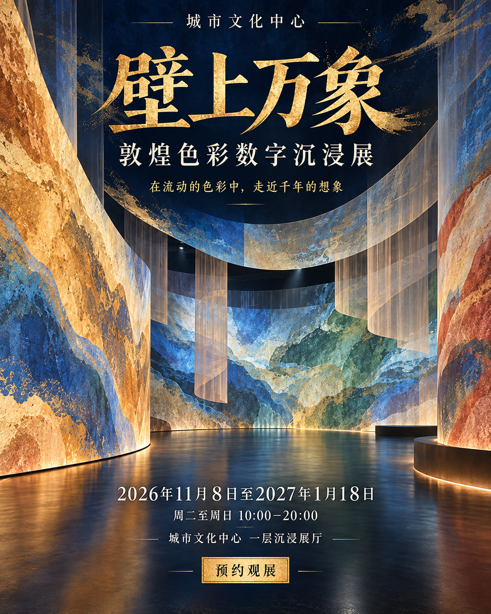
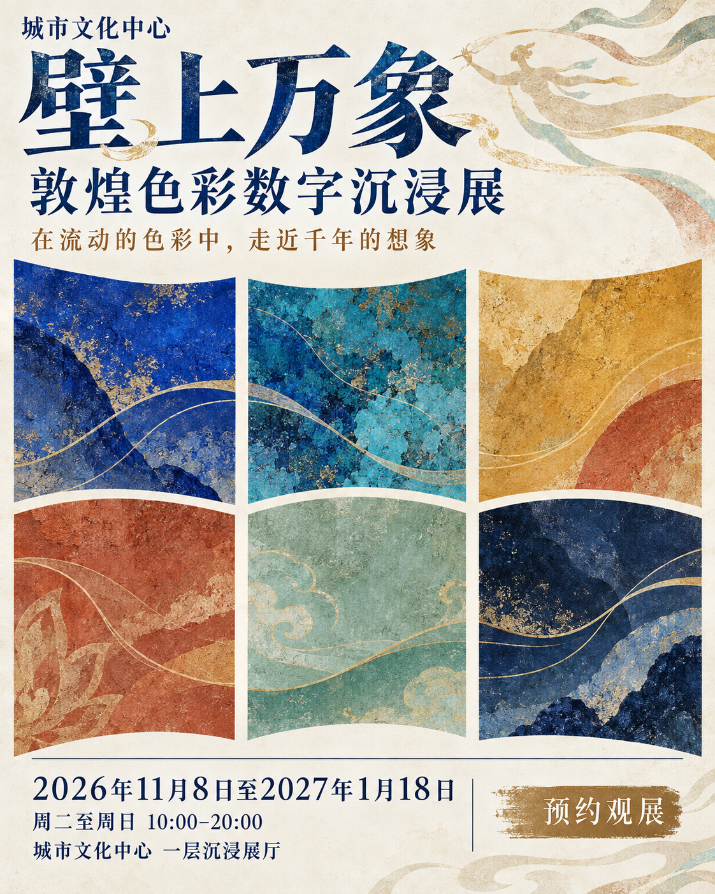

# 文化活动宣传主视觉

**从活动资料到四版选稿，再到中英文海报。**

一个面向展览、艺术节、阅读节、文化市集与非遗活动的设计 Skill。将信息整理、视觉选择和图像生成连接起来，在关键设计决策处停下来，让使用者参与选择。

## 工作流程

```text
活动资料 → 确认简报与双语文案 ⏸
        → 选择视觉类别       ⏸
        → 生成四张中文候选   ⏸
        → 用户选稿与修改
        → 中文版 + 英文版 PNG
```

默认最终交付：中文、英文各一张，竖版4:5 PNG，目标2400×3000 px。实际生成尺寸取决于所用工具；交付前需要核验，不把目标规格当成已实现规格。

## 六种视觉类别

| 类别 | 主要视觉语言 |
|---|---|
| 国风叙事与传统插画 | 人物场景、工艺叙事、纸本肌理 |
| 现代东方与意象构成 | 文化符号提炼、流动色层、现代留白 |
| 趣味插画与角色场景 | 扁平角色、夸张动作、鲜明色彩 |
| 轻盈手绘与自然诗性 | 疏朗线描、淡彩、自然意象 |
| 几何符号与字体构成 | 大标题、几何模块、清晰网格 |
| 复古印刷与实验拼贴 | 颗粒、套色、剪贴与非规则排版 |

活动类型与视觉风格分开选择。例如非遗活动也可以采用现代东方设计；同一类别内的四版必须有实质创意和构图差异，而不只是换色。

## 快速开始

将仓库下载解压，把整个文件夹命名为 `cultural-event-poster-design`，放到 Codex 的技能目录 `~/.codex/skills/`。文件夹内应直接包含 `SKILL.md`。

在支持加载本地 Skill 的环境中调用：

```text
使用 $cultural-event-poster-design，为我的文化活动制作宣传主视觉。
活动名称：……
主题内容：……
时间和地点：……
目标观众：……
必须使用的素材和文案：……
```

也可以先提供活动资料文件，让助手提取信息。缺失信息会集中询问；已有官方英文文案会保留，不擅自重译。

## 运行环境

- 能读取 Skill 和本地附件的 AI 助手。
- 可调用的图像生成与编辑工具；本项目在 Codex 内置 imagegen 下进行了中文候选试运行。
- Skill 本身是工作流指引，不包含独立图像模型，也不提供 API 密钥。
- 没有图像工具时，会说明限制，不用提示词或网页冒充 PNG 成图。

## 试运行示例：壁上万象

以下为课程案例“壁上万象：敦煌色彩数字沉浸展”的中文候选，展示同一简报下的四种处理。它们不是已发布展览的公告，也不是完成验收的双语终稿。

| A · 流动色幕 | B · 穿壁入境 |
|---|---|
|  |  |
| 明亮舒展，曲面色幕与留白 | 深蓝与金色，突出展厅纵深 |

| C · 字中万象 | D · 敦煌色谱 |
|---|---|
|  |  |
| 大字主导，强调展名识别 | 六块色谱组织平面视觉 |

示例实际尺寸为1122×1402 px，近似4:5；严格比例处理和英文对应版尚未完成。本仓库不宣称这些候选已满足最终交付标准。

## 文件结构

```text
SKILL.md                   核心流程与三个断点
agents/openai.yaml         Codex 技能展示信息
references/                简报、分类、生成与验收规范
evals/evals.json            流程测试场景
examples/                  中文候选示例
```

## 更新与维护

以 GitHub 仓库中的文件作为维护源。修改技能时同步更新相关说明，检查相对文件引用、断点行为与交付数量，再提交 Git 版本记录。修改后的文件需要同步到本地已安装技能目录，才能保证本地运行版本一致。

向助手提出“更新这个技能，并同步到 GitHub”即可发起一次更新任务；这不等于后台持续监控或自动上传任意本地改动。

## 使用边界

不编造活动信息、官方译名、机构标识或二维码。不将参考海报上的内容直接当作新活动事实。示例图用于说明工作流程，使用外部作品、Logo或真实展品素材时需自行确认相应使用条件。
